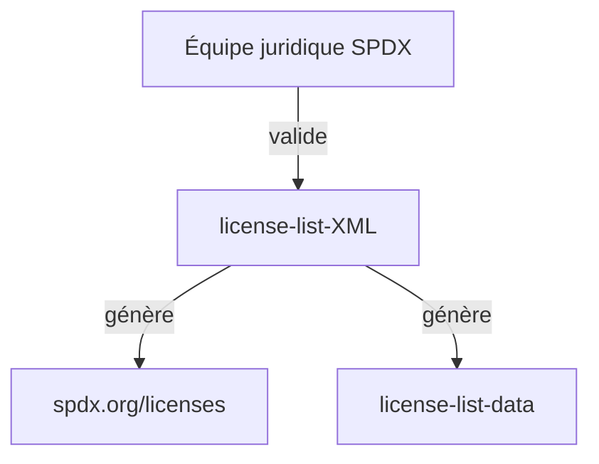

# spdx/license-list-XML

> XML sources and schemas of the official SPDX license list, with its identifiers and texts.

## The problem
Reliably identifying a license in code, a dataset or an SBOM requires unique reference identifiers and texts.

## What it actually does
Contains the source XML of each license and exception (short identifier, name, validated text, matching rules, permanent URL), from which spdx.org/licenses and the license-list-data repo formats are generated. Releases come out about every quarter.

## How it is wired
Simplified diagram based on the fiche, no diagram provided.


## Trying it
```bash
# Aucune commande documentée : le dépôt se consulte et se contribue via issues et PR.
```

## Cost and gotchas
Free. A license missing from the list is written with the `LicenseRef-` prefix. New requests follow the quarterly schedule.

## What it is not
Not a license scanner: it is the source of the list, not a tool that analyzes your code.

## Alternatives
No alternative named in the README.

## For you
Watch: a useful reference for checking the licenses of models and dependencies, to consult rather than install.
