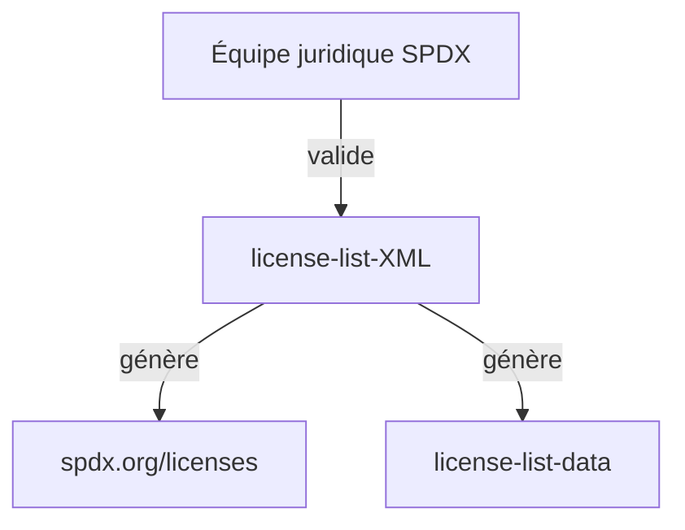

# spdx/license-list-XML

> Sources XML et schémas de la liste officielle des licences SPDX, de leurs identifiants et de leurs textes.

## Le problème
Identifier de façon fiable une licence dans un code, un jeu de données ou une SBOM demande des identifiants et des textes de référence uniques.

## Ce que ça fait vraiment
Contient le XML source de chaque licence et exception (identifiant court, nom, texte validé, règles de correspondance, URL permanente), d'où sont générés spdx.org/licenses et les formats du dépôt license-list-data. Les versions sortent environ chaque trimestre.

## Comment c'est branché
Schéma simplifié d'après la fiche, sans diagramme fourni.


## Essayer
```bash
# Aucune commande documentée : le dépôt se consulte et se contribue via issues et PR.
```

## Coût et pièges
Gratuit. Une licence absente de la liste s'écrit avec le préfixe `LicenseRef-`. Les nouvelles demandes suivent le calendrier trimestriel.

## Ce que ce n'est pas
Pas un scanneur de licences : c'est la source de la liste, pas un outil qui analyse ton code.

## Alternatives
Aucune alternative nommée dans le README.

## Pour toi
À surveiller : référence utile pour vérifier les licences de modèles et de dépendances, à consulter plutôt qu'à installer.

