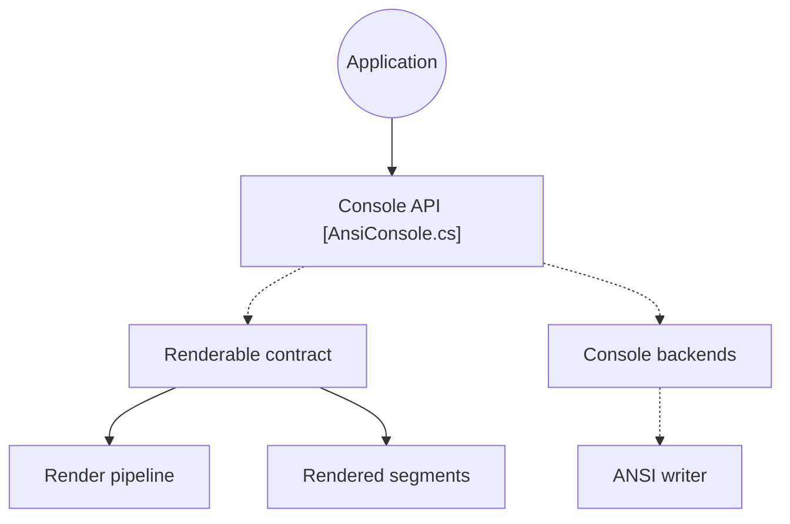

# spectreconsole/spectre.console

> A .NET library for building rich console applications, inspired by the Python library Rich.

## The problem
Raw console output is poor: few tables, colors or progress bars without hand-written ANSI code.

## What it actually does
Tables, grids, panels, a markup language inspired by Rich, SGR text styles and 3/4/8/24-bit colors with terminal capability detection. It also offers prompts, live displays and progress, plus JSON and image extensions. A test console lets you capture the output.

## How it is wired


## Trying it
```bash
dotnet add package Spectre.Console
```

## Cost and gotchas
Free. The .NET SDK is required, and it is missing from the prerequisites list. The project is backed by the .NET Foundation.

## What it is not
Not a Python library: it is inspired by Rich but serves the .NET ecosystem.

## Alternatives
- Rich: the Python library that inspired it, to be preferred if you code in Python.

## For you
Ignore: if you want this rendering in Python, use Rich directly.
