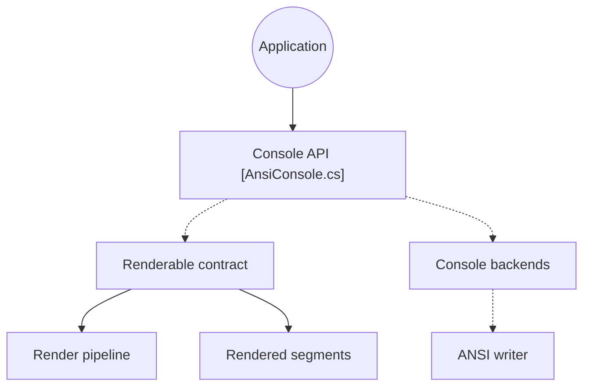

# spectreconsole/spectre.console

> Bibliothèque .NET pour créer des applications console riches, inspirée de la bibliothèque Python Rich.

## Le problème
Les sorties console brutes sont pauvres : peu de tableaux, de couleurs ou de barres de progression sans code ANSI manuel.

## Ce que ça fait vraiment
Tableaux, grilles, panneaux, un langage de balisage inspiré de Rich, styles de texte SGR et couleurs 3/4/8/24 bits avec détection des capacités du terminal. Elle offre aussi invites, affichages en direct et progression, et des extensions JSON et image. Une console de test permet de capturer la sortie.

## Comment c'est branché


## Essayer
```bash
dotnet add package Spectre.Console
```

## Coût et pièges
Gratuit. Il faut le SDK .NET, absent de la liste de prérequis. Le projet est soutenu par la .NET Foundation.

## Ce que ce n'est pas
Pas une bibliothèque Python : elle s'inspire de Rich mais sert l'écosystème .NET.

## Alternatives
- Rich : la bibliothèque Python qui l'a inspirée, à préférer si tu codes en Python.

## Pour toi
À ignorer : si tu veux ce rendu en Python, utilise directement Rich.

