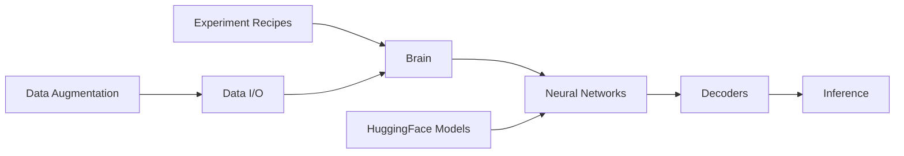

# speechbrain/speechbrain

> PyTorch toolkit for speech, text and EEG: training recipes and pretrained models.

## The problem
Each audio task (ASR, speaker, separation, TTS) has its own research code, hard to compare and reuse.

## What it actually does
200+ recipes over 40+ datasets for 20 tasks: ASR, speaker recognition, separation, enhancement, TTS, SLU, diarization, EEG...
`Brain` class for training loops, YAML hyperparameters, multi-GPU, mixed precision, dynamic batching.
100+ models on Hugging Face with three-line inference interfaces.
Integrations with Hugging Face (wav2vec2, Whisper), Orion, k2, WebDataset.

## How it is wired


## Trying it
```bash
pip install speechbrain
git clone https://github.com/speechbrain/speechbrain.git
cd speechbrain
pip install -r requirements.txt
pip install --editable .
pytest tests
```

## Cost and gotchas
Free, Apache-2.0; GPU needed for training, recipe logs and checkpoints hosted on Dropbox.

## What it is not
Not a turnkey transcription API service.
Research-oriented: real-time production use is a future goal ("scale down").

## Alternatives
No alternative named in the README.

## For you
Adopt as soon as a project touches audio: reproducible recipes and ready models save you from starting over from paper code.
