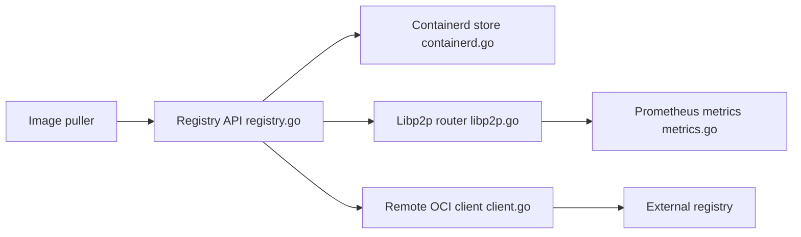

# spegel-org/spegel

> Stateless OCI image registry mirror for Kubernetes clusters, which shares the cache between nodes.

## The problem
Image pulls from external registries are slow, rate-limited (Docker Hub) and fail if the registry goes down.

## What it actually does
The README is very short. From the code: Spegel serves a registry API that answers from the local containerd storage, otherwise from peers or the external registry; content availability is shared via libp2p. It also exposes Prometheus metrics and a web interface.

## How it is wired

## Trying it
No command in the README: it points to a getting-started guide. Command not documented here.

## Cost and gotchas
Assumes a Kubernetes cluster with containerd. The project states: evolving API, no guaranteed support, best-effort help, aimed at home labs and individual contributors.

## What it is not
Not a standalone registry nor a solution with commercial support. README material insufficient to judge beyond this.

## Alternatives
No alternative named in the README.

## For you
Worth watching: relevant only if you operate a Kubernetes cluster and want to save image bandwidth; otherwise of no interest.
