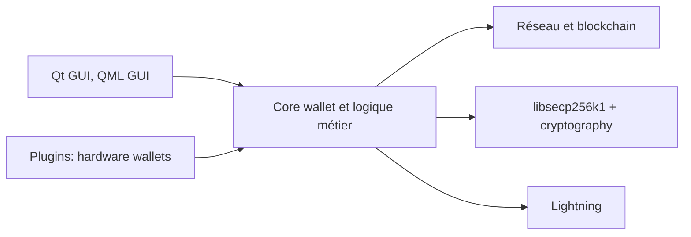

# spesmilo/electrum

> Lightweight Bitcoin wallet in Python, with Qt and QML interfaces.

## The problem
Holding and spending bitcoins without downloading the whole blockchain.

## What it actually does
The README mostly describes installation from source and the tests. According to the architecture described from the code: wallet core (wallet, transactions, network), Qt and QML interfaces, cryptography via libsecp256k1 and `cryptography`, hardware wallet plugins (Trezor, Ledger, Coldcard), and Lightning modules. Build scripts produce a tarball, AppImage, macOS, Windows and Android builds.

## How it is wired


## Trying it
```bash
sudo apt-get install libsecp256k1-dev
ELECTRUM_ECC_DONT_COMPILE=1 python3 -m pip install --user ".[gui,crypto]"
./run_electrum
pytest tests -v
```

## Cost and gotchas
Free. Python 3.10+, libsecp256k1 (compiled or provided) and PyQt6 for the Qt interface. 1,241 open issues. A wallet handles funds: install only from the official source.

## What it is not
Not a full node nor a blockchain data analysis tool. The README does not detail the product's features.

## Alternatives
No alternative named in the README.

## For you
Ignore: crypto wallet unrelated to data/AI/MLOps work.
