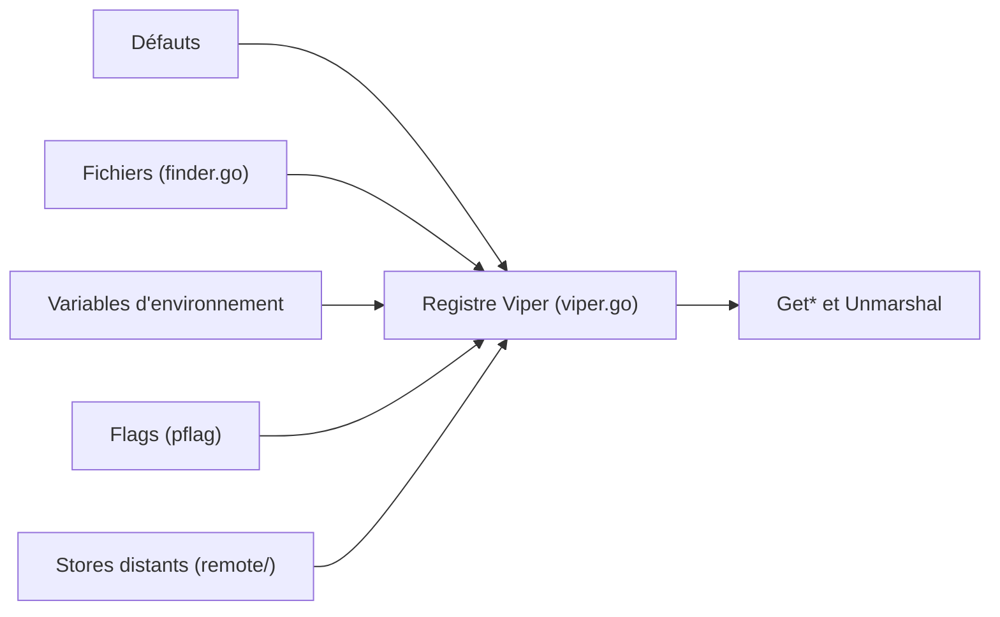

# spf13/viper

> Go configuration library: files, environment variables, flags and remote stores merged into one registry.

## The problem
A Go application reads its configuration from files, the environment, flags and sometimes etcd or Consul, each with its own logic.

## What it actually does
Merges the sources with a fixed priority order: explicit Set, flags, environment variables, files, key/value stores, defaults. It reads JSON, TOML, YAML, INI, envfile and properties, watches file changes, reads etcd, Consul, Firestore or NATS, handles aliases and unmarshals into structs. Keys are case-insensitive and subsets are available via Sub.

## How it is wired


## Trying it
```bash
go get github.com/spf13/viper
make test
make lint
```

## Cost and gotchas
Free. No deep merge: an overridden complex value replaces the whole. Not safe for concurrent read/write access (possible panic). The global singleton is discouraged. The project announces a v2 and favors stability over new features.

## What it is not
Not a secrets manager: encryption goes through crypt and an optional GPG keyring. Not suited if you want to move fast: new features wait for v2.

## Alternatives
No alternative cited in the README.

## For you
Worth watching: a reference for configuring Go tools, but of no direct interest if your data/AI work stays in Python.
