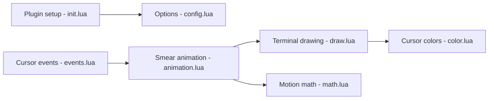

# sphamba/smear-cursor.nvim

> Neovim plugin that animates the cursor with a trail effect in every terminal.

## The problem
In a text terminal, the cursor jumps from one position to another without animation, unlike Neovide or Kitty.

## What it actually does
Animates cursor movement with a trail drawn in characters, including across buffers, between neighboring lines and in insert mode. Stiffness, damping, color and particles are configurable; a "smooth cursor" mode without a trail exists. Known limitation: a shadow around the trail and a probable incompatibility with other plugins that touch the cursor.

## How it is wired


## Trying it
```bash
# lazy.nvim : ajouter { "sphamba/smear-cursor.nvim", opts = {} }
:SmearCursorToggle
```

## Cost and gotchas
Free. Neovim 0.10.2 minimum. Some terminals force their own cursor color: set it by hand. A font with "legacy computing" symbols improves rendering.

## What it is not
Not a productivity plugin: purely visual. No support outside Neovim.

## Alternatives
neoscroll.nvim (smooth scrolling, complementary); Neovide (animated cursor in a graphical client).

## For you
Ignore: a visual gadget; install it only out of taste if you work in Neovim.
