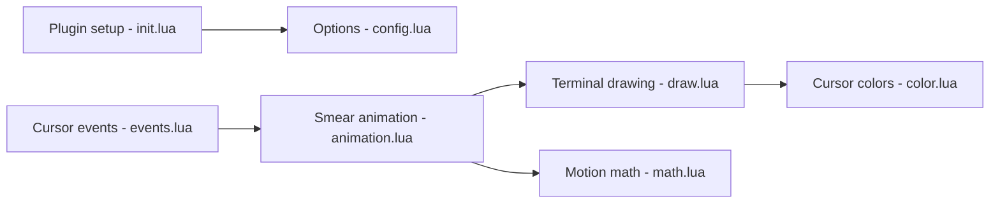

# sphamba/smear-cursor.nvim

> Plugin Neovim qui anime le curseur avec un effet de traînée dans tous les terminaux.

## Le problème
Dans un terminal texte, le curseur saute d'une position à l'autre sans animation, contrairement à Neovide ou Kitty.

## Ce que ça fait vraiment
Anime le déplacement du curseur par une traînée dessinée en caractères, y compris entre buffers, lignes voisines et en mode insertion. Raideur, amortissement, couleur et particules se règlent ; un mode « curseur lisse » sans traînée existe. Limite connue : une ombre autour de la traînée et une probable incompatibilité avec d'autres plugins touchant au curseur.

## Comment c'est branché


## Essayer
```bash
# lazy.nvim : ajouter { "sphamba/smear-cursor.nvim", opts = {} }
:SmearCursorToggle
```

## Coût et pièges
Gratuit. Neovim 0.10.2 minimum. Certains terminaux imposent leur couleur de curseur : la régler à la main. Une police avec symboles « legacy computing » améliore le rendu.

## Ce que ce n'est pas
Pas un plugin de productivité : purement visuel. Pas de support sans Neovim.

## Alternatives
neoscroll.nvim (défilement fluide, complémentaire) ; Neovide (curseur animé dans un client graphique).

## Pour toi
Ignorer : gadget visuel ; à installer seulement par goût si tu travailles sous Neovim.

