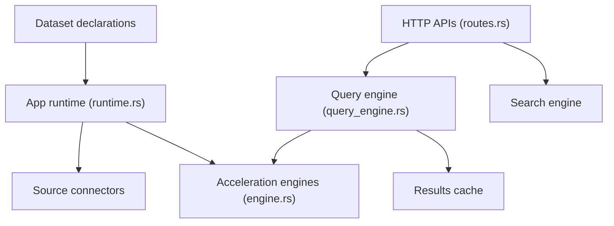

# spiceai/spiceai

> Data and AI engine in Rust: federated SQL, search and LLM inference behind one API.

## The problem
Connecting applications and agents to several data sources requires pipelines, caches and LLM gateways assembled by hand.

## What it actually does
You declare datasets in `spicepod.yaml` (over 30 connectors). Spice can keep an accelerated copy (Cayenne engine, DuckDB, Arrow, SQLite), refreshed or fed by CDC from PostgreSQL, MySQL and MongoDB. It serves SQL (HTTP, Flight SQL, JDBC, ODBC), vector and full-text search, text-to-SQL, OpenAI-compatible APIs and MCP.

## How it is wired


## Trying it
```bash
/plugin marketplace add spiceai/skills
```
No installation command in the part of the README that was read.

## Cost and gotchas
The Apache-2.0 runtime is free; Spice.ai Cloud and Enterprise are separate offerings. Hosted LLMs require your own keys. Many open issues (976). Performance figures are the vendor's.

## What it is not
Not a reference database: it copies and federates. Some features (Drasi, CDC catalog) are in alpha.

## Alternatives
Apache DataFusion, DuckDB, Spark and Debezium, cited in the README as building blocks or points of comparison.

## For you
Worth watching: relevant for RAG and agents on existing data, with a broad functional surface to test before committing.
