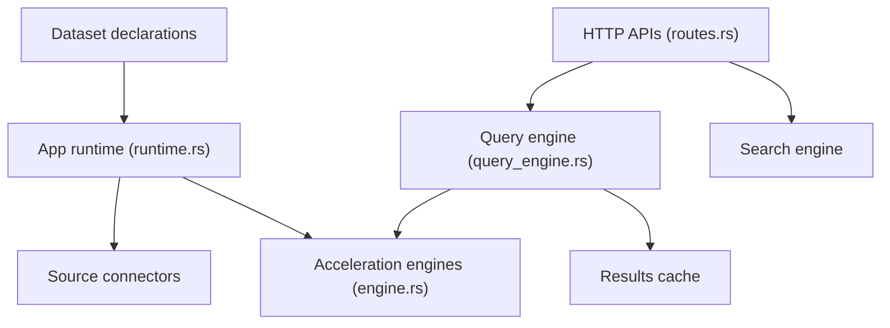

# spiceai/spiceai

> Moteur de données et d'IA en Rust : SQL fédéré, recherche et inférence LLM derrière une API.

## Le problème
Brancher des applications et des agents sur plusieurs sources de données demande pipelines, caches et passerelles LLM assemblés à la main.

## Ce que ça fait vraiment
On déclare les jeux de données dans `spicepod.yaml` (plus de 30 connecteurs). Spice peut en garder une copie accélérée (moteur Cayenne, DuckDB, Arrow, SQLite), rafraîchie ou alimentée par CDC depuis PostgreSQL, MySQL et MongoDB. Il sert du SQL (HTTP, Flight SQL, JDBC, ODBC), de la recherche vectorielle et plein texte, du text-to-SQL, des API compatibles OpenAI et du MCP.

## Comment c'est branché


## Essayer
```bash
/plugin marketplace add spiceai/skills
```
Aucune commande d'installation dans la partie lue du README.

## Coût et pièges
Runtime Apache-2.0 gratuit ; Spice.ai Cloud et Enterprise sont des offres à part. Les LLM hébergés demandent tes propres clés. Beaucoup d'issues ouvertes (976). Les chiffres de performance sont ceux de l'éditeur.

## Ce que ce n'est pas
Pas une base de données de référence : il copie et fédère. Certaines fonctions (Drasi, catalogue CDC) sont en alpha.

## Alternatives
Apache DataFusion, DuckDB, Spark et Debezium, cités dans le README comme briques ou points de comparaison.

## Pour toi
À surveiller : pertinent pour du RAG et des agents sur des données existantes, avec une surface fonctionnelle large à tester avant de s'engager.

