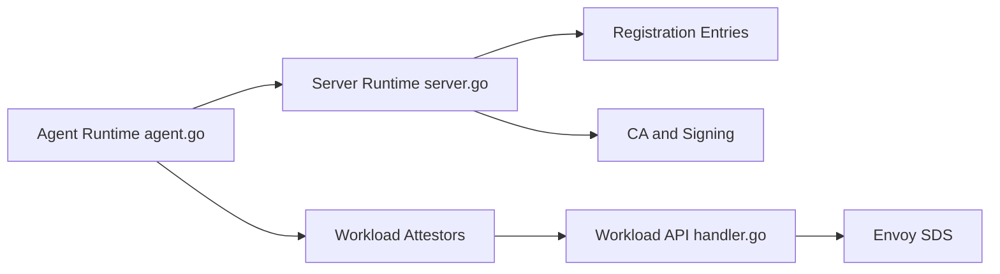

# spiffe/spire

> SPIFFE workload identity system: a server and agents that issue verifiable identities.

## The problem
Services must authenticate to each other (mTLS, JWT) without static secrets or dependence on a specific hosting platform.

## What it actually does
A server and agents attest nodes and then workloads, and issue X.509 or JWT SVIDs through the Workload API. Compatible with Envoy via SDS, with trust bundle federation and an extensible plugin framework. Graduated CNCF project; Cure53 (2021) and SIG-Security audits cited.

## How it is wired


## Trying it
```bash
# Aucune commande dans le README : releases sur
# https://github.com/spiffe/spire/releases ; guides de démarrage Kubernetes, Linux, macOS
```

## Cost and gotchas
Free. Requires a server + agents deployment and some architectural thought; the README points to the scaling guide.

## What it is not
Not a secrets manager or a service mesh: the README points to a comparison page. Not a tool to try in five minutes.

## Alternatives
No alternative named in the README.

## For you
Watch: relevant for securing MLOps services on Kubernetes, but oversized for a small project.
