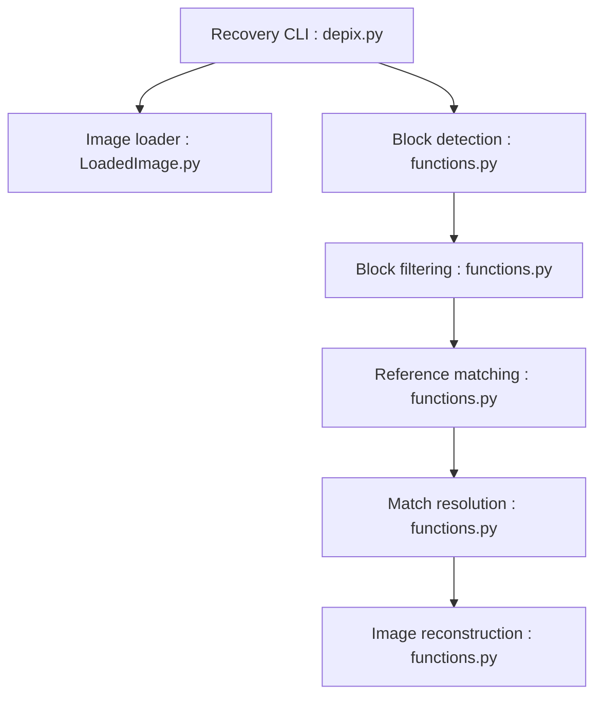

# spipm/Depixelization_poc

> Command-line proof of concept that recovers pixelated text by comparing blocks to a reference image.

## The problem
Text hidden by pixelation can sometimes be reconstructed.

## What it actually does
The README only says "Migrated to codeberg.org/spipm/Depixelization_poc". From the code (GitDiagram): loads the pixelated image and a search image, detects and filters blocks, looks for matches, resolves them geometrically and writes the reconstructed image. A pixelation generator and a box-display tool exist.

## How it is wired


## Trying it
```bash
# Aucune commande documentée dans le README (il ne contient qu'un lien de migration).
```

## Cost and gotchas
Archived repository, development moved to Codeberg. README has no technical content: insufficient material.

## What it is not
Not a tool maintained here. No guarantee of recovery: proof of concept.

## Alternatives
- The Codeberg repository named in the README: that is where the project now lives.

## For you
Ignore here: archived and undocumented; if the subject interests you (pixelation leak risk), go to Codeberg.
