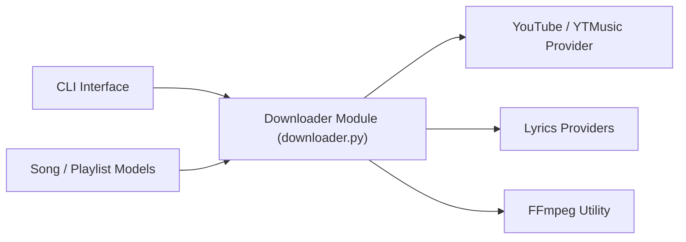

# spotDL/spotify-downloader

> Command-line tool that finds the tracks of a Spotify playlist on YouTube and downloads them.

## The problem
Keeping your Spotify playlists offline with metadata, cover art and lyrics is impossible through the app itself.

## What it actually does
From Spotify URLs, it reads the metadata, searches for the matching audio on YouTube via yt-dlp, downloads with FFmpeg and embeds cover art, lyrics and tags. Operations: `download`, `save`, `sync`, `url`, `meta`, `web`. Lyrics providers (Genius, Musixmatch, AZLyrics) are modular. The audio bitrate is YouTube's: 128 kbps, 256 for YouTube Music premium.

## How it is wired


## Trying it
```bash
pip install spotdl
spotdl --download-ffmpeg
spotdl [urls]
docker run --rm -v $(pwd):/music spotdl download [trackUrl]
```

## Cost and gotchas
Free. FFmpeg is required; Deno recommended for some videos. The README warns that users are responsible for the legal consequences and does not encourage unauthorized downloading of protected content.

## What it is not
It is not a download from Spotify: the source is YouTube. The web interface is limited to individual tracks.

## Alternatives
- No alternative named in the README.

## For you
Ignore: hobby use with copyright-related legal risk, and no link with data/AI work.
