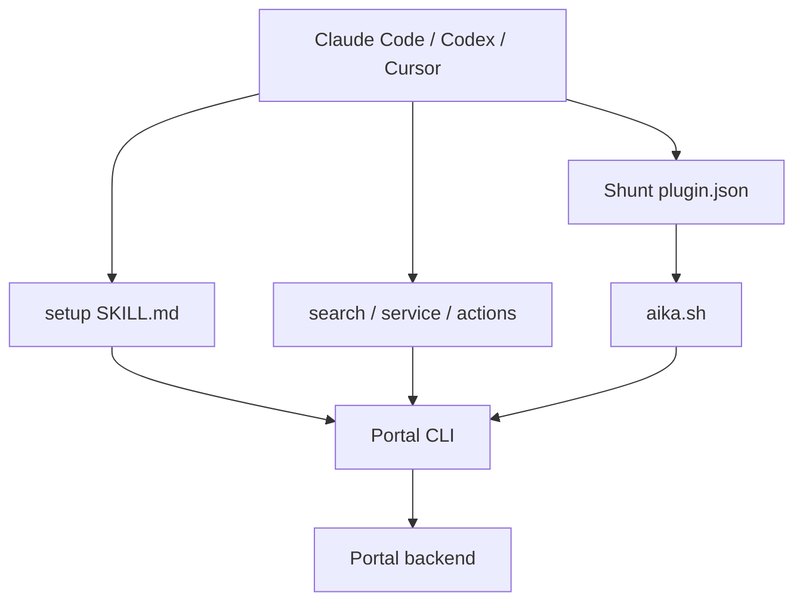

# spotify/portal-ai-plugins

> Plugins for Claude Code, Codex, Cursor and pi that connect the agent to Spotify Portal.

## The problem
Teams that use Spotify Portal have to leave their agent to look up a service, check its status or trigger an action.

## What it actually does
Skills call `npx @spotify/portal-cli`: setup (authentication), doctor (read-only diagnostics), search (catalog and docs), service (operational sheet), actions (help, dry-run, confirmation, invocation), feedback, plus five Fleetshift workflows. The optional `shunt` plugin (Claude Code) delegates bulk reads and code generation to cheaper AiKA modes, with guard hooks. The repository implements no API: everything goes through the CLI and the Portal backend.

## How it is wired


## Trying it
```bash
claude plugin marketplace add spotify/portal-ai-plugins
claude plugin install portal@portal
claude plugin install shunt@portal
pi install git:github.com/spotify/portal-ai-plugins
```
Then `/portal:setup` in Claude Code.

## Cost and gotchas
Free but useless without access to an authenticated Spotify Portal instance. Depends on the external CLI and backend.

## What it is not
Not a standalone tool nor a service catalog: a layer of skills on top of a third-party product.

## Alternatives
None named in the README.

## For you
Ignore unless your organization runs Spotify Portal: without it, the repository brings nothing. The delegation pattern of `shunt` remains an idea worth reading.
