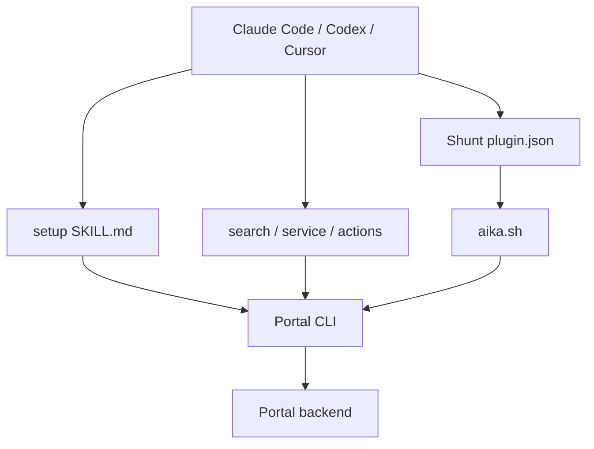

# spotify/portal-ai-plugins

> Plugins pour Claude Code, Codex, Cursor et pi qui branchent l'agent sur Spotify Portal.

## Le problème
Les équipes qui utilisent Spotify Portal doivent quitter leur agent pour chercher un service, vérifier son état ou lancer une action.

## Ce que ça fait vraiment
Des skills appellent `npx @spotify/portal-cli` : setup (authentification), doctor (diagnostic en lecture seule), search (catalogue et docs), service (fiche opérationnelle), actions (aide, dry-run, confirmation, invocation), feedback, plus cinq workflows Fleetshift. Le plugin optionnel `shunt` (Claude Code) délègue lectures massives et génération de code à des modes AiKA moins coûteux, avec des hooks de garde. Le dépôt n'implémente aucune API : tout passe par le CLI et le backend Portal.

## Comment c'est branché


## Essayer
```bash
claude plugin marketplace add spotify/portal-ai-plugins
claude plugin install portal@portal
claude plugin install shunt@portal
pi install git:github.com/spotify/portal-ai-plugins
```
Puis `/portal:setup` dans Claude Code.

## Coût et pièges
Gratuit mais inutile sans accès à une instance Spotify Portal authentifiée. Dépend du CLI et du backend externes.

## Ce que ce n'est pas
Pas un outil autonome ni un catalogue de services : une couche de skills sur un produit tiers.

## Alternatives
Aucune nommée dans le README.

## Pour toi
À ignorer sauf si ton organisation exploite Spotify Portal : sans lui, le dépôt n'apporte rien. Le motif de délégation de `shunt` reste une idée à lire.

