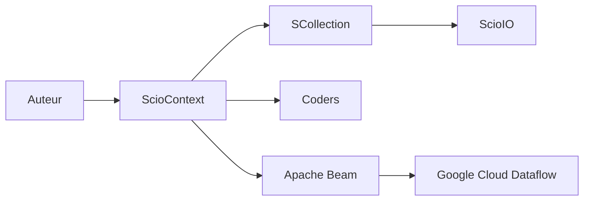

# spotify/scio

> Scala API for Apache Beam and Google Cloud Dataflow, for data engineers writing batch and streaming pipelines.

## The problem
Writing Beam pipelines in Java is verbose; Scala teams want an API close to Spark or Scalding.

## What it actually does
A `ScioContext` creates `SCollection`s that are transformed and then written through IOs (text, Avro, BigQuery, Pub/Sub, Bigtable, Parquet, JDBC, Redis, TensorFlow…). Coders and schemas handle serialization, BigQuery is typed at compile time. Interactive REPL, distributed cache, test modules.

## How it is wired


## Trying it
```bash
sbt new spotify/scio.g8
cd scio-job
sbt stage
target/universal/stage/bin/scio-job --output=wc
```

## Cost and gotchas
JDK 11 or later, sbt. Managed execution on Dataflow is billed by Google Cloud; local mode is free.

## What it is not
Not a compute engine: it delegates to Beam. Scala only.

## Alternatives
The README compares it with Spark and Scalding (comparison docs) and points to the Beam Programming Guide.

## For you
Watch: relevant only if you have Scala and GCP; otherwise Beam in Python or Spark cover the need.
