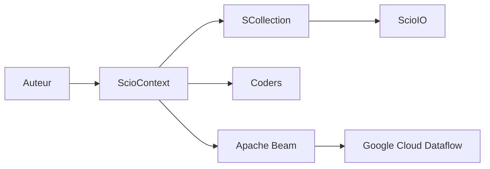

# spotify/scio

> API Scala pour Apache Beam et Google Cloud Dataflow, pour data engineers qui écrivent des pipelines batch et streaming.

## Le problème
Écrire des pipelines Beam en Java est verbeux ; les équipes Scala veulent une API proche de Spark ou Scalding.

## Ce que ça fait vraiment
Un `ScioContext` crée des `SCollection` transformées puis écrites via des IO (texte, Avro, BigQuery, Pub/Sub, Bigtable, Parquet, JDBC, Redis, TensorFlow…). Coders et schémas gèrent la sérialisation, BigQuery est typé à la compilation. REPL interactif, cache distribué, modules de test.

## Comment c'est branché


## Essayer
```bash
sbt new spotify/scio.g8
cd scio-job
sbt stage
target/universal/stage/bin/scio-job --output=wc
```

## Coût et pièges
JDK 11 ou plus, sbt. L'exécution gérée sur Dataflow est facturée par Google Cloud ; le mode local est gratuit.

## Ce que ce n'est pas
Pas un moteur de calcul : il délègue à Beam. Scala uniquement.

## Alternatives
Le README compare à Spark et Scalding (docs de comparaison) et renvoie au Beam Programming Guide.

## Pour toi
À surveiller : pertinent seulement si tu as du Scala et GCP ; sinon Beam en Python ou Spark couvrent le besoin.

