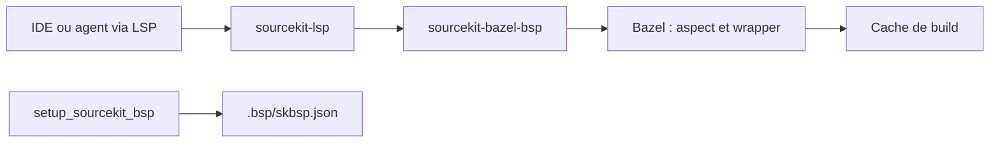

# spotify/sourcekit-bazel-bsp

> Build Server Protocol server that connects sourcekit-lsp to Bazel for iOS development in any IDE.

## The problem
Apple projects built with Bazel have no indexing (completion, go to definition) outside Xcode.

## What it actually does
A BSP bridge between sourcekit-lsp and Bazel: Swift, Obj-C and C++ indexing in Cursor, VSCode, Sublime or via Claude Code's LSP. In Cursor/VSCode, a companion extension adds build, launch, debugging (lldb-dap), tests and simulators. A `setup_sourcekit_bsp` rule generates the configuration files; an aspect compiles libraries through their parent target to share the cache.

## How it is wired


## Trying it
```bash
bazel run //:setup_sourcekit_bsp
log stream --process sourcekit-bazel-bsp --debug
lldb --attach-name sourcekit-bazel-bsp --wait-for
```

## Cost and gotchas
Free, but requires a Bazel project (no WMO), the Swift 6.1+ toolchain and Xcode installed for the toolchains; Xcode 26 to build the tool. The first indexing can be long.

## What it is not
Does not work with a regular Xcode project. Does not spare you from installing Xcode.

## Alternatives
xcode-build-server, cited for ordinary Xcode projects (unrelated to this project).

## For you
Ignore: outside your data/AI scope, it only serves iOS teams on Bazel; adopt it only if that is your case.
