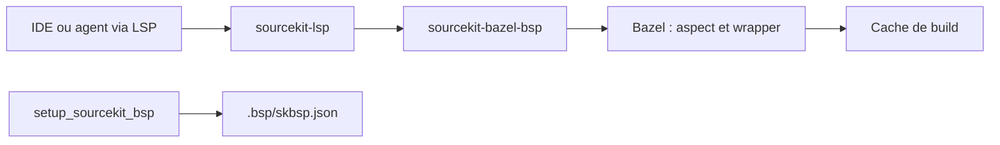

# spotify/sourcekit-bazel-bsp

> Serveur Build Server Protocol qui relie sourcekit-lsp à Bazel pour développer iOS dans n'importe quel IDE.

## Le problème
Les projets Apple construits avec Bazel n'ont pas d'indexation (complétion, aller à la définition) hors de Xcode.

## Ce que ça fait vraiment
Un pont BSP entre sourcekit-lsp et Bazel : indexation Swift, Obj-C et C++ dans Cursor, VSCode, Sublime ou via le LSP de Claude Code. Dans Cursor/VSCode, une extension compagnon ajoute build, lancement, débogage (lldb-dap), tests et simulateurs. Une règle `setup_sourcekit_bsp` génère les fichiers de configuration ; un aspect compile les bibliothèques via leur cible parente pour partager le cache.

## Comment c'est branché


## Essayer
```bash
bazel run //:setup_sourcekit_bsp
log stream --process sourcekit-bazel-bsp --debug
lldb --attach-name sourcekit-bazel-bsp --wait-for
```

## Coût et pièges
Gratuit, mais exige un projet Bazel (pas de WMO), la chaîne Swift 6.1+ et Xcode installé pour les toolchains ; Xcode 26 pour compiler l'outil. La première indexation peut être longue.

## Ce que ce n'est pas
Ne fonctionne pas avec un projet Xcode classique. Ne dispense pas d'installer Xcode.

## Alternatives
xcode-build-server, cité pour les projets Xcode ordinaires (sans lien avec ce projet).

## Pour toi
À ignorer : hors de ton périmètre data/IA, il ne sert qu'aux équipes iOS sous Bazel ; adopte-le seulement si c'est ton cas.

