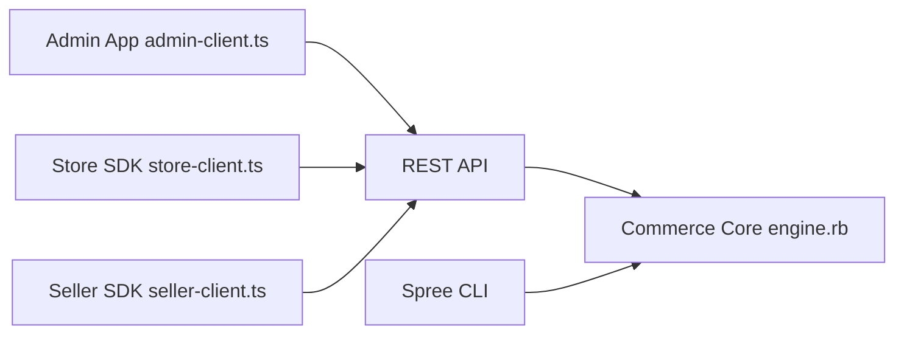

# spree/spree

> Open source Rails e-commerce platform with a REST API, React admin and Next.js storefront, for web teams.

## The problem
Setting up a shop, a marketplace or a B2B channel without locking yourself into an e-commerce SaaS.

## What it actually does
Rails backend with a REST API and TypeScript SDKs (store, admin, seller), React dashboard (Vite, TanStack), seller panel for marketplaces, optional Next.js storefront. Handles B2B pricing, multi-currency markets, Stripe/Adyen/PayPal payments, promotions, inventory. A CLI and a local MCP server let an agent drive the shop.

## How it is wired


## Trying it
```bash
npx create-spree-app@latest my-store
```

## Cost and gotchas
Node 24+ and Docker required. The core is free (BSD-3-Clause); multi-tenant SaaS, B2B approval workflows, audit and SLA support belong to the paid Enterprise edition.

## What it is not
Not no-code: it is a codebase to customize. Nothing to do with data or ML.

## Alternatives
No alternative named in the README.

## For you
Worth watching: solid but outside the data/AI core; useful only if you must build a shop, the MCP server being the AI angle.
