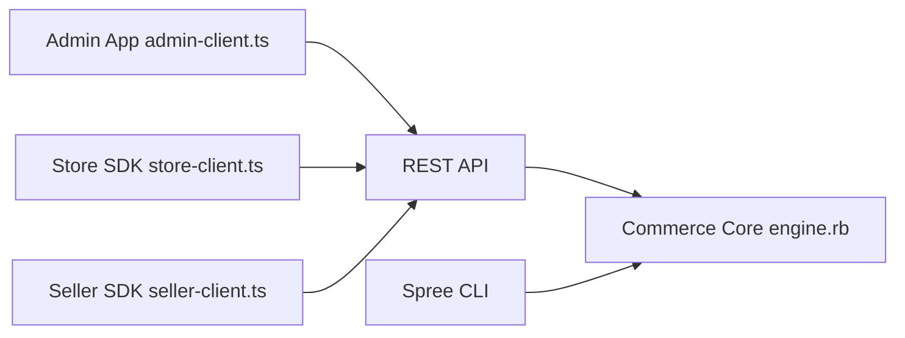

# spree/spree

> Plateforme e-commerce open source Rails avec API REST, admin React et vitrine Next.js, pour équipes web.

## Le problème
Monter une boutique, une place de marché ou un canal B2B sans s'enfermer chez un SaaS e-commerce.

## Ce que ça fait vraiment
Backend Rails avec API REST et SDK TypeScript (store, admin, seller), tableau de bord React (Vite, TanStack), panneau vendeur pour marketplace, vitrine Next.js optionnelle. Gère prix B2B, marchés multi-devises, paiements Stripe/Adyen/PayPal, promotions, stocks. Un CLI et un serveur MCP local permettent de piloter la boutique par agent.

## Comment c'est branché


## Essayer
```bash
npx create-spree-app@latest my-store
```

## Coût et pièges
Node 24+ et Docker requis. Le noyau est gratuit (BSD-3-Clause) ; multi-tenant SaaS, workflows d'approbation B2B, audit et support SLA relèvent de l'édition Enterprise payante.

## Ce que ce n'est pas
Pas du no-code : c'est une base de code à personnaliser. Rien à voir avec la donnée ou le ML.

## Alternatives
Aucune alternative nommée dans le README.

## Pour toi
Surveiller : solide mais hors du cœur data/IA ; utile seulement si tu dois bâtir une boutique, le serveur MCP étant l'angle IA.

