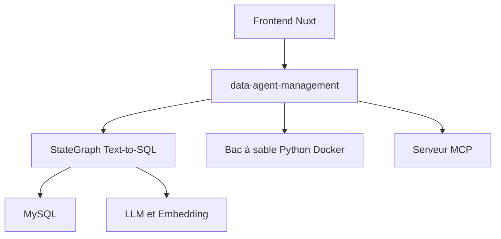

# spring-ai-alibaba/DataAgent

> Data analysis agent in Java: Text-to-SQL, sandboxed Python analysis and reports with charts.

## The problem
Querying a business database in natural language requires translating to SQL, analyzing, then presenting the results, which simple Text-to-SQL tools do not complete end to end.

## What it actually does
Based on Spring AI Alibaba Graph, it converts a question into SQL (multi-table, multi-turn), runs Python in containers via the Spring AI Alibaba sandbox, then produces an HTML or Markdown report with ECharts charts. A plan can be corrected by the human. RAG search covers business metadata, and it also serves as an MCP server. It accepts any OpenAI-compatible model.

## How it is wired
Simplified diagram based on the fiche, no diagram provided.



## Trying it
```bash
mysql -u root -p < data-agent-management/src/main/resources/sql/schema.sql
./mvnw -pl data-agent-management spring-boot:run
cd data-agent-frontend-nuxt
pnpm install && pnpm dev
```

## Cost and gotchas
Requires JDK 17+, MySQL 5.7+, Node 22+, pnpm 11+ and Docker for the Python steps. Access to a chat and embedding model is at your expense. 165 open issues.

## What it is not
Not a Python library: it is a complete Java and Nuxt stack. Documentation is in Chinese.

## Alternatives
No alternative is named in the README.

## For you
Worth watching: a complete Text-to-SQL approach with a sandbox, interesting for natural-language analytics, if your stack accepts Java.
