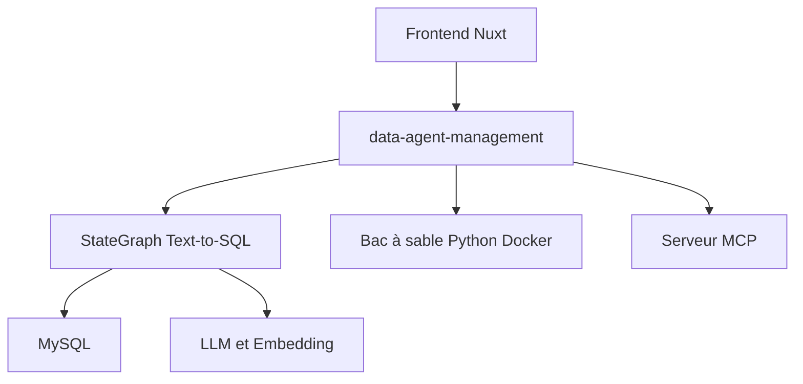

# spring-ai-alibaba/DataAgent

> Agent d'analyse de données en Java : Text-to-SQL, analyse Python en bac à sable et rapports avec graphiques.

## Le problème
Interroger une base métier en langage naturel exige de traduire en SQL, d'analyser puis de présenter les résultats, ce que les outils Text-to-SQL simples ne bouclent pas.

## Ce que ça fait vraiment
Basé sur Spring AI Alibaba Graph, il convertit une question en SQL (multi-tables, multi-tours), exécute du Python dans des conteneurs via le bac à sable Spring AI Alibaba, puis produit un rapport HTML ou Markdown avec graphiques ECharts. Un plan peut être corrigé par l'humain. La recherche RAG porte sur les métadonnées métier, et il sert aussi de serveur MCP. Il accepte tout modèle compatible OpenAI.

## Comment c'est branché
Schéma simplifié d'après la fiche, sans diagramme fourni.



## Essayer
```bash
mysql -u root -p < data-agent-management/src/main/resources/sql/schema.sql
./mvnw -pl data-agent-management spring-boot:run
cd data-agent-frontend-nuxt
pnpm install && pnpm dev
```

## Coût et pièges
Il faut JDK 17+, MySQL 5.7+, Node 22+, pnpm 11+ et Docker pour les étapes Python. L'accès à un modèle de chat et d'embedding est à ta charge. 165 issues ouvertes.

## Ce que ce n'est pas
Ce n'est pas une bibliothèque Python : c'est une pile Java et Nuxt complète. La documentation est en chinois.

## Alternatives
Aucune alternative n'est nommée dans le README.

## Pour toi
À surveiller : approche complète du Text-to-SQL avec bac à sable, intéressante pour l'analytique en langage naturel, si ta pile accepte Java.

