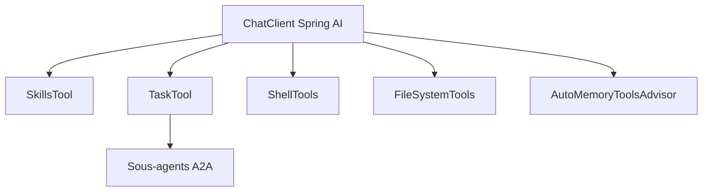

# spring-ai-community/spring-ai-agent-utils

> Spring AI library that reimplements Claude Code's tools for Java agents.

## The problem
Building a coding agent in Java means rewriting the file, shell, search and sub-agent tools that Claude Code provides.

## What it actually does
Provides Spring AI tools: FileSystemTools, ShellTools, GrepTool, GlobTool, SmartWebFetchTool, BraveWebSearchTool, TodoWriteTool. Adds SkillsTool (skills in Markdown), TaskTools for sub-agents (including A2A), long-term memory and cooperative stopping of the tool loop.

## How it is wired
Simplified diagram based on the sheet, no diagram provided.



## Trying it
```bash
mvn clean install
cd examples/code-agent-demo
mvn spring-boot:run
```

## Cost and gotchas
Requires Java 17+, Maven and Spring AI 2.0.0 or later. A model and a BRAVE_API_KEY for web search: the model bill is on you. ShellTools runs commands: sandbox it.

## What it is not
Not a ready-to-use agent: a set of tools to assemble. Not for Python.

## Alternatives
- Claude Code: the original tool, which the repository says it imitates.

## For you
Keep an eye on it: only useful if your team writes agents in Java and Spring, otherwise of no interest.
