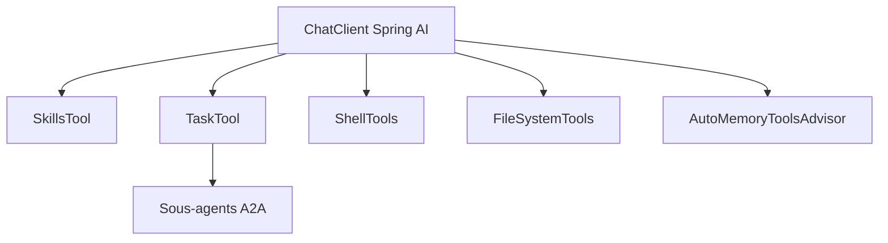

# spring-ai-community/spring-ai-agent-utils

> Bibliothèque Spring AI qui réimplémente les outils de Claude Code pour des agents Java.

## Le problème
Construire un agent de code en Java oblige à réécrire les outils de fichiers, shell, recherche et sous-agents que Claude Code fournit.

## Ce que ça fait vraiment
Fournit des outils Spring AI : FileSystemTools, ShellTools, GrepTool, GlobTool, SmartWebFetchTool, BraveWebSearchTool, TodoWriteTool. Ajoute SkillsTool (skills en Markdown), TaskTools pour les sous-agents (dont A2A), une mémoire longue durée et un arrêt coopératif de la boucle d'outils.

## Comment c'est branché
Schéma simplifié d'après la fiche, sans diagramme fourni.



## Essayer
```bash
mvn clean install
cd examples/code-agent-demo
mvn spring-boot:run
```

## Coût et pièges
Nécessite Java 17+, Maven et Spring AI 2.0.0 ou plus. Un modèle et une clé BRAVE_API_KEY pour la recherche web : facture de modèle à ta charge. ShellTools exécute des commandes : à sandboxer.

## Ce que ce n'est pas
Pas un agent prêt à l'emploi : un jeu d'outils à assembler. Pas pour Python.

## Alternatives
- Claude Code : l'outil d'origine, que le dépôt dit imiter.

## Pour toi
Surveiller : utile seulement si ton équipe écrit des agents en Java et Spring, sinon sans intérêt.

