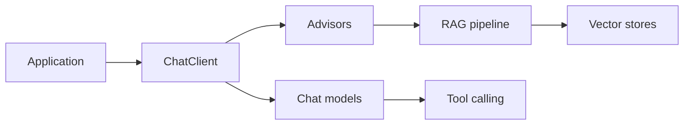

# spring-projects/spring-ai

> Spring abstractions to plug AI models, vector stores and tools into Java applications.

## The problem
Integrating LLMs, RAG and tools into a Spring application without tying yourself to each provider's SDK.

## What it actually does
Portable API for chat, embeddings, image, audio, moderation; structured outputs mapped to POJOs; tool calling; fluent ChatClient, advisors, conversation memory, RAG pipeline and document ETL; MCP support (client and server); about twenty vector stores listed; observability.

## How it is wired


## Trying it
```bash
./mvnw clean install
```
The README rather recommends consuming the artifacts and the "Getting Started" guide; building from source is only useful for the latest version.

## Cost and gotchas
API key for the chosen provider at your expense. Compatibility: Spring AI 2.x with Spring Boot 4.x, 1.1.x with Spring Boot 3.5.x.

## What it is not
Not a model or a platform: a Java integration layer. Of little relevance outside the JVM ecosystem.

## Alternatives
No alternative named in the README (Awesome Spring AI and Spring AI Community are related resources).

## For you
Keep an eye on it: adopt if your AI services run on Spring Boot; in Python, this building block is of no use to you.
