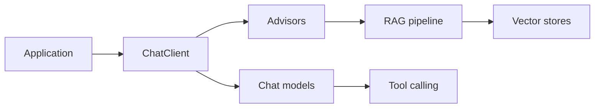

# spring-projects/spring-ai

> Abstractions Spring pour brancher modèles d'IA, vector stores et outils dans des applications Java.

## Le problème
Intégrer des LLM, de la RAG et des outils dans une application Spring sans coller au SDK de chaque fournisseur.

## Ce que ça fait vraiment
API portable pour chat, embeddings, image, audio, modération ; sorties structurées mappées en POJO ; tool calling ; ChatClient fluide, advisors, mémoire de conversation, pipeline RAG et ETL de documents ; support MCP (client et serveur) ; une vingtaine de vector stores listés ; observabilité.

## Comment c'est branché


## Essayer
```bash
./mvnw clean install
```
Le README recommande plutôt de consommer les artefacts et le guide « Getting Started » ; le build source n'est utile que pour la dernière version.

## Coût et pièges
Clé d'API du fournisseur choisi à ta charge. Compatibilité : Spring AI 2.x avec Spring Boot 4.x, 1.1.x avec Spring Boot 3.5.x.

## Ce que ce n'est pas
Pas un modèle ni une plateforme : une couche d'intégration Java. Peu pertinent hors écosystème JVM.

## Alternatives
Aucune alternative nommée dans le README (Awesome Spring AI et Spring AI Community sont des ressources liées).

## Pour toi
Surveiller : à adopter si tes services IA sont en Spring Boot ; en Python, cette brique ne te sert à rien.

