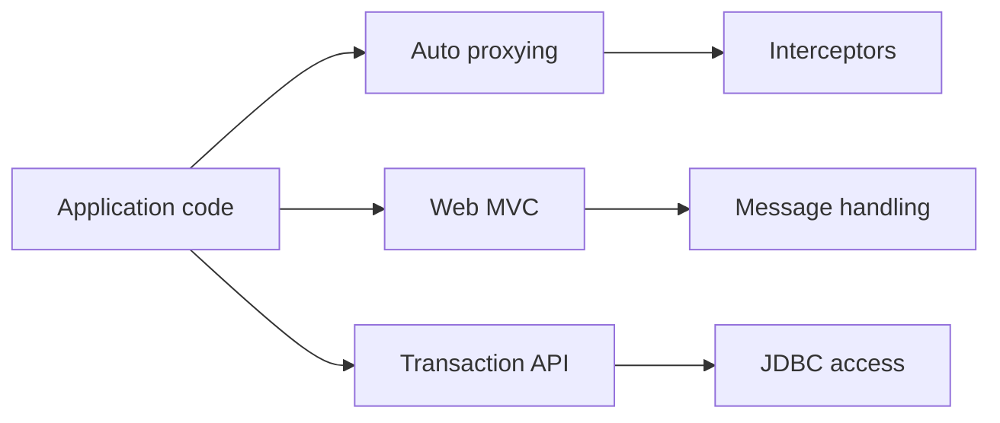

# spring-projects/spring-framework

> Java foundation for enterprise applications: injection, AOP, web, transactions and messaging.

## The problem
Enterprise Java applications need common infrastructure (configuration, transactions, web and data access).

## What it actually does
Provides type conversion, AOP proxies, transaction management, Web MVC and reactive web, WebSocket, messaging, JDBC and ORM access, caching and scheduling. Components managed by the framework are wrapped by interceptors; the README points to the reference documentation for the overview.

## How it is wired

## Trying it
The README contains no command: see the "Build from Source" section of `CONTRIBUTING.md` and the artifacts wiki.

## Cost and gotchas
Free. Very short README material: everything goes through the external documentation.

## What it is not
Not an application or a ready-to-use server: a library for Java developers.

## Alternatives
No alternative named in the README.

## For you
Ignore for a Python-centered data / AI profile, unless you integrate Java services.
