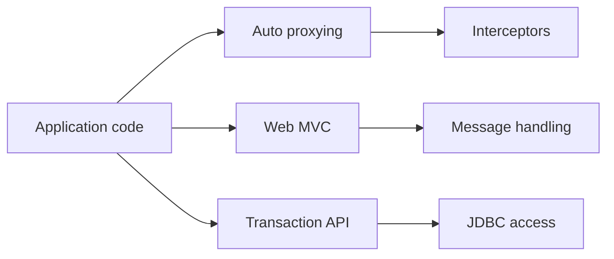

# spring-projects/spring-framework

> Fondation Java pour applications d'entreprise : injection, AOP, web, transactions et messagerie.

## Le problème
Les applications Java d'entreprise ont besoin d'une infrastructure commune (configuration, transactions, accès web et données).

## Ce que ça fait vraiment
Fournit conversion de types, proxys AOP, gestion des transactions, Web MVC et web réactif, WebSocket, messagerie, accès JDBC et ORM, cache et planification. Les composants gérés par le framework sont enveloppés par des intercepteurs ; le README renvoie vers la documentation de référence pour la présentation.

## Comment c'est branché

## Essayer
Le README ne contient pas de commande : voir la section « Build from Source » de `CONTRIBUTING.md` et le wiki des artefacts.

## Coût et pièges
Gratuit. Matière du README très courte : tout passe par la documentation externe.

## Ce que ce n'est pas
Pas une application ni un serveur prêt à l'emploi : une bibliothèque pour développeurs Java.

## Alternatives
Aucune alternative nommée dans le README.

## Pour toi
À ignorer pour un profil data / IA centré Python, sauf si tu intègres des services Java.

