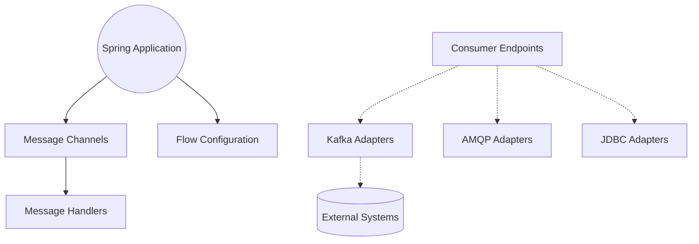

# spring-projects/spring-integration

> Spring extension for assembling message flows following enterprise integration patterns.

## The problem
Connecting external systems (message queues, HTTP, JDBC, files) without coupling the components to each other is difficult.

## What it actually does
POJOs are linked by message channels, handlers and endpoints. Adapters (one-way) and gateways (request/reply) talk AMQP, Kafka, HTTP, TCP/UDP, WebSocket, JDBC, Cassandra, files. Configuration goes through annotations, Java DSL or XML; a flow graph is exposed by an API.

## How it is wired


## Trying it
```bash
git clone git://github.com/spring-projects/spring-integration.git
cd spring-integration
./gradlew clean test
```
Maven dependency: `spring-integration-core`, then `@EnableIntegration`.

## Cost and gotchas
Free. The build requires a Java 17 compiler; the long test is run with `./gradlew clean testAll`. No PHP, Ruby or Python: you need the whole Java and Spring ecosystem.

## What it is not
Not a message broker: it adapts existing systems, it does not provide one.

## Alternatives
No alternative named in the README.

## For you
Ignore, unless you ingest Kafka streams in a Spring application; otherwise Python tools are enough.
