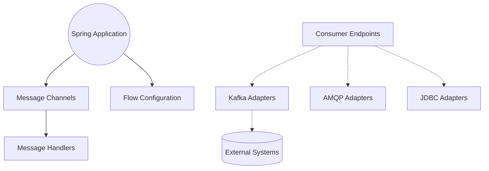

# spring-projects/spring-integration

> Extension de Spring pour assembler des flux de messages selon les motifs d'intégration d'entreprise.

## Le problème
Brancher des systèmes externes (files de messages, HTTP, JDBC, fichiers) sans coupler les composants entre eux est difficile.

## Ce que ça fait vraiment
Des POJO sont reliés par des canaux de messages, des handlers et des endpoints. Des adaptateurs (sens unique) et des passerelles (requête/réponse) parlent AMQP, Kafka, HTTP, TCP/UDP, WebSocket, JDBC, Cassandra, fichiers. La configuration passe par annotations, DSL Java ou XML ; un graphe de flux est exposé par une API.

## Comment c'est branché


## Essayer
```bash
git clone git://github.com/spring-projects/spring-integration.git
cd spring-integration
./gradlew clean test
```
Dépendance Maven : `spring-integration-core`, puis `@EnableIntegration`.

## Coût et pièges
Gratuit. La build exige un compilateur Java 17 ; le test long se lance avec `./gradlew clean testAll`. Pas de PHP, Ruby ni Python : il faut tout l'écosystème Java et Spring.

## Ce que ce n'est pas
Ce n'est pas un broker de messages : il adapte des systèmes existants, il n'en fournit pas.

## Alternatives
Aucune alternative nommée dans le README.

## Pour toi
À ignorer, sauf si tu ingères des flux Kafka dans une application Spring ; sinon des outils Python suffisent.

