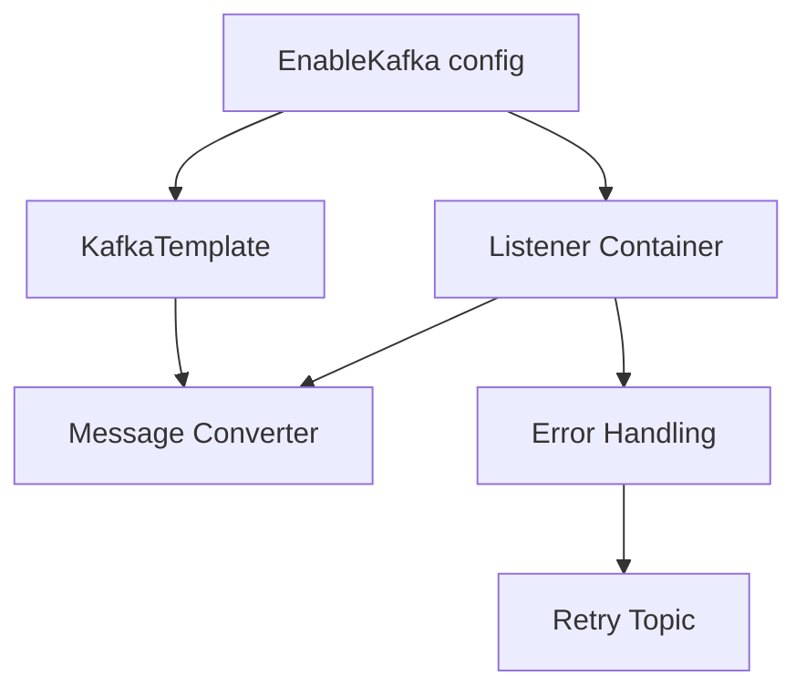

# spring-projects/spring-kafka

> Spring integration for Apache Kafka: producers and consumers in Java applications.

## The problem
Connecting Kafka to a Spring application without rewriting the handling of consumers, transactions and errors.

## What it actually does
Provides KafkaTemplate for producing and a listener container for consuming, with the @KafkaListener annotation. According to the generated diagram: message conversion, transactions, error handler, retry topics, Kafka Streams support, security, Micrometer metrics and an embedded broker for tests. The README itself only explains how to build.

## How it is wired


## Trying it
```bash
git clone git://github.com/spring-projects/spring-kafka.git
cd spring-kafka
./gradlew build
./gradlew install
```

## Cost and gotchas
Free. Java 17 or later recommended to build (increase memory in gradle.properties if needed). A Kafka broker still has to be provided.

## What it is not
Not a Kafka broker nor a data streaming tool: only the glue on the JVM application side.

## Alternatives
No alternative named in the README.

## For you
Worth watching only if your real-time data or scoring pipeline goes through Java services; otherwise a Python client is enough.
