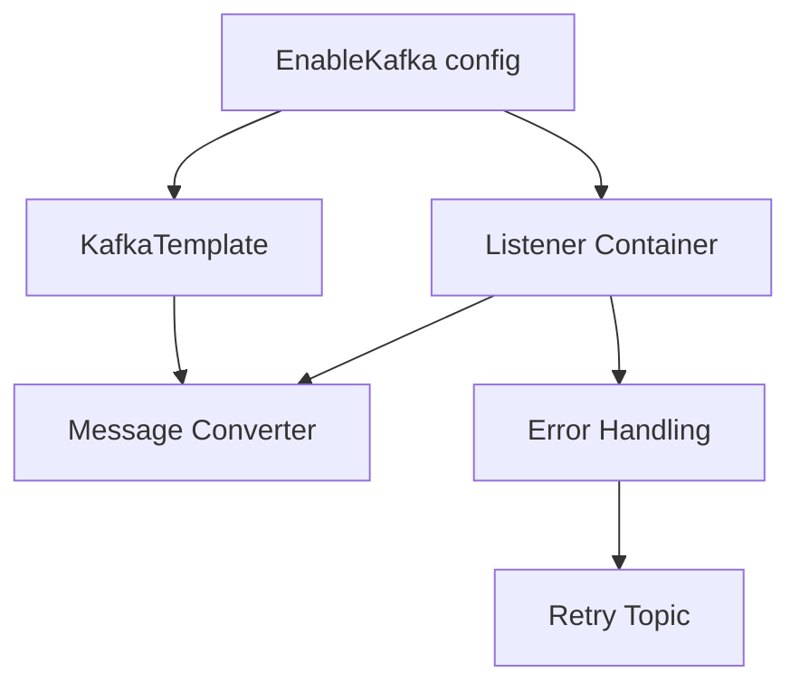

# spring-projects/spring-kafka

> Intégration Spring pour Apache Kafka : producteurs et consommateurs dans les applications Java.

## Le problème
Brancher Kafka à une application Spring sans réécrire la gestion des consommateurs, des transactions et des erreurs.

## Ce que ça fait vraiment
Fournit KafkaTemplate pour produire et un conteneur d'écoute pour consommer, avec l'annotation @KafkaListener. D'après le schéma généré : conversion de messages, transactions, gestionnaire d'erreurs, reprise par topics, support Kafka Streams, sécurité, métriques Micrometer et un broker embarqué pour les tests. Le README, lui, n'explique que la compilation.

## Comment c'est branché


## Essayer
```bash
git clone git://github.com/spring-projects/spring-kafka.git
cd spring-kafka
./gradlew build
./gradlew install
```

## Coût et pièges
Gratuit. Java 17 ou plus recommandé pour compiler (mémoire à augmenter dans gradle.properties si besoin). Un broker Kafka reste à fournir.

## Ce que ce n'est pas
Pas un broker Kafka ni un outil de streaming de données : seulement la colle côté application JVM.

## Alternatives
Aucune alternative nommée dans le README.

## Pour toi
À surveiller seulement si ton pipeline de données ou de scoring en temps réel passe par des services Java ; sinon un client Python suffit.

