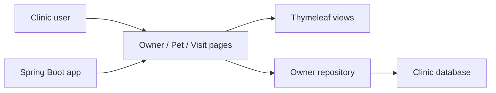

# spring-projects/spring-petclinic

> Sample Spring Boot veterinary clinic application, for learning or demonstrating the framework.

## The problem
Having a realistic, runnable Spring Boot project at hand to test a stack, a tool or a training course.

## What it actually does
Manages owners, pets, visits and a list of veterinarians, rendered as Thymeleaf pages. In-memory H2 database by default; MySQL and PostgreSQL profiles available. Integration tests via Testcontainers (MySQL) and Docker Compose (Postgres).

## How it is wired


## Trying it
```bash
git clone https://github.com/spring-projects/spring-petclinic.git
cd spring-petclinic
./mvnw spring-boot:run
```
Then http://localhost:8080. Gradle variant: `./gradlew bootRun`.

## Cost and gotchas
Free. Java 17+. No Dockerfile: the image is built with `./mvnw spring-boot:build-image`. H2 console exposed at `/h2-console`.

## What it is not
Not a production template: it is a demo. The linked slides describe a version that predates Spring Boot.

## Alternatives
No alternative named in the README (forks for other stacks are in the spring-petclinic organization).

## For you
Ignore: no link to data/AI/MLOps, unless you are learning Spring.
