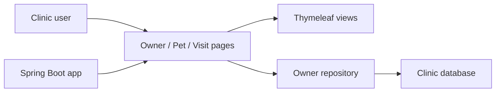

# spring-projects/spring-petclinic

> Application d'exemple Spring Boot de clinique vétérinaire, pour apprendre ou démontrer le framework.

## Le problème
Avoir un projet Spring Boot réaliste et exécutable sous la main pour tester une pile, un outil ou une formation.

## Ce que ça fait vraiment
Gère propriétaires, animaux, visites et liste de vétérinaires, rendus en pages Thymeleaf. Base H2 en mémoire par défaut ; profils MySQL et PostgreSQL disponibles. Tests d'intégration via Testcontainers (MySQL) et Docker Compose (Postgres).

## Comment c'est branché


## Essayer
```bash
git clone https://github.com/spring-projects/spring-petclinic.git
cd spring-petclinic
./mvnw spring-boot:run
```
Puis http://localhost:8080. Variante Gradle : `./gradlew bootRun`.

## Coût et pièges
Gratuit. Java 17+. Pas de Dockerfile : l'image se construit avec `./mvnw spring-boot:build-image`. Console H2 exposée sur `/h2-console`.

## Ce que ce n'est pas
Pas un modèle de production : c'est une démo. Les diapositives liées décrivent une version antérieure à Spring Boot.

## Alternatives
Aucune alternative nommée dans le README (les forks d'autres piles sont dans l'organisation spring-petclinic).

## Pour toi
Ignorer : aucun lien avec data/IA/MLOps, sauf si tu apprends Spring.

