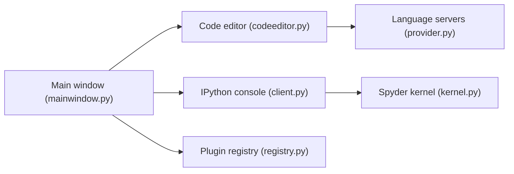

# spyder-ide/spyder

> Desktop Python development environment for scientists, engineers and data analysts.

## The problem
Exploring data in Python requires combining an editor, an interactive console, variable inspection and debugging in a single tool.

## What it actually does
Qt IDE (PyQt5) with a multi-language editor (pyflakes/pylint analysis, jedi/rope completion through language servers), multiple IPython consoles, a variable explorer (NumPy, pandas, images), a Sphinx documentation viewer, a debugger, a profiler, projects and file search. Extensible plugin system.

## How it is wired

## Trying it
The README gives no command, only the recommended method: install via Anaconda and `conda`. Alternatives listed: pip, WinPython, MacPorts, Linux package managers.

## Cost and gotchas
Free. Limited support outside an Anaconda installation, according to the README. Python 3.11+ and PyQt5 5.15+ required. 1,350 open issues.

## What it is not
Not a notebook: it is a desktop IDE in the MATLAB style. No AI assistance described in the README.

## Alternatives
None named in the README.

## For you
Adopt it if you prefer a scientific IDE with a variable explorer; mature, MIT, actively maintained.
