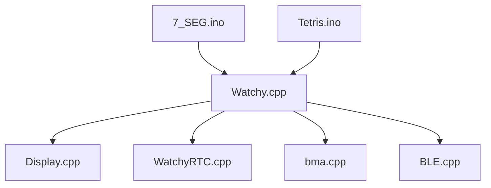

# sqfmi/Watchy

> Fully open source e-paper smartwatch, programmable with Arduino.

## The problem
Smartwatches are closed; you want a watch whose hardware and software you control.

## What it actually does
Arduino library: `Watchy.cpp` orchestrates the display, the RTC clock, the accelerometer and Bluetooth. Watch faces (7_SEG, Tetris, Basic) inherit from this class. The README points to the online guide; the material is very thin.

## How it is wired
Diagram based on the code diagram.



## Trying it
```bash
# README : aucune commande, voir https://watchy.sqfmi.com/docs/getting-started
```

## Cost and gotchas
You have to buy the watch (Mouser, The Pi Hut, Crowd Supply). Last push in August 2025, more than a year ago.

## What it is not
Not standalone software: without the hardware, it is useless.

## Alternatives
No alternative named in the README.

## For you
Ignore: a hardware project unrelated to your field, and not very active.
