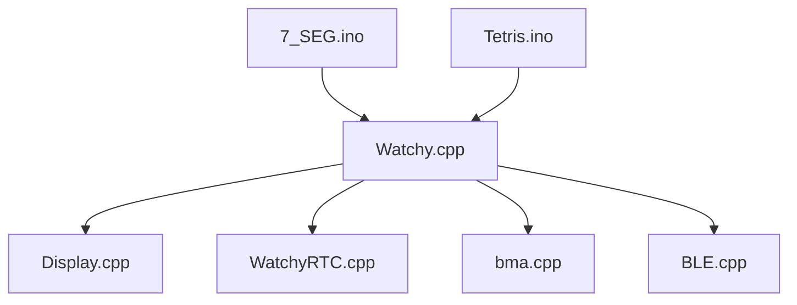

# sqfmi/Watchy

> Montre connectée à écran e-paper entièrement open source, programmable en Arduino.

## Le problème
Les montres connectées sont fermées ; on voudrait une montre dont on contrôle le matériel et le logiciel.

## Ce que ça fait vraiment
Bibliothèque Arduino : `Watchy.cpp` orchestre l'affichage, l'horloge RTC, l'accéléromètre et le Bluetooth. Les cadrans (7_SEG, Tetris, Basic) héritent de cette classe. Le README renvoie au guide en ligne ; la matière est très mince.

## Comment c'est branché
Schéma d'après le diagramme du code.



## Essayer
```bash
# README : aucune commande, voir https://watchy.sqfmi.com/docs/getting-started
```

## Coût et pièges
Il faut acheter la montre (Mouser, The Pi Hut, Crowd Supply). Dernier push en août 2025, soit plus d'un an.

## Ce que ce n'est pas
Pas un logiciel autonome : sans le matériel, il ne sert à rien.

## Alternatives
Aucune alternative nommée dans le README.

## Pour toi
À ignorer : projet matériel sans lien avec ton métier, et peu actif.

