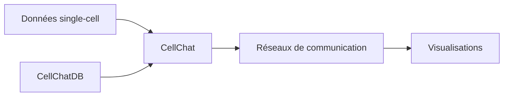

# sqjin/CellChat

> R package to infer and visualize cell-cell communication from single-cell data (old version).

## The problem
Identifying which cells communicate through which ligand-receptor pairs in single-cell data.

## What it actually does
Infers communication networks, characterizes them (social network analysis, pattern recognition, manifold learning), predicts incoming and outgoing signals, compares conditions, and produces visualizations. CellChatDB: an annotated multi-species database of ligand-receptor pairs. The repo is archived: the project has moved to jinworks/CellChat (v2).

## How it is wired


## Trying it
```bash
# Aucune commande dans le README ; le dépôt n'est plus maintenu.
```

## Cost and gotchas
Free. Archived repo, last push January 2024: use the new jinworks/CellChat repo.

## What it is not
Not the current version: the README says so at the top.

## Alternatives
jinworks/CellChat, the successor indicated in the README.

## For you
Ignore: archived and specialized in biology; if needed, start from the successor repo.
