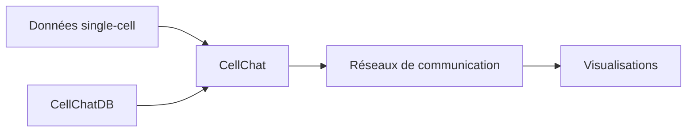

# sqjin/CellChat

> Package R pour inférer et visualiser la communication cellule-cellule à partir de données single-cell (ancienne version).

## Le problème
Identifier quelles cellules communiquent via quels couples ligand-récepteur dans des données single-cell.

## Ce que ça fait vraiment
Infère les réseaux de communication, les caractérise (analyse de réseaux sociaux, reconnaissance de motifs, manifold learning), prédit les signaux entrants et sortants, compare les conditions, produit des visualisations. CellChatDB : base annotée de couples ligand-récepteur multi-espèces. Le dépôt est archivé : le projet a migré vers jinworks/CellChat (v2).

## Comment c'est branché


## Essayer
```bash
# Aucune commande dans le README ; le dépôt n'est plus maintenu.
```

## Coût et pièges
Gratuit. Dépôt archivé, dernier push janvier 2024 : utiliser le nouveau dépôt jinworks/CellChat.

## Ce que ce n'est pas
Pas la version actuelle : le README le dit en tête.

## Alternatives
jinworks/CellChat, successeur indiqué dans le README.

## Pour toi
À ignorer : archivé et spécialisé en biologie ; si besoin, partir du dépôt successeur.

