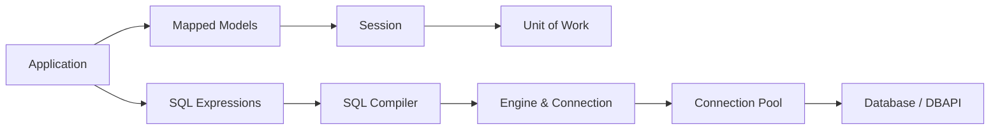

# sqlalchemy/sqlalchemy

> The reference Python SQL and ORM toolkit, from explicit SQL to mapped objects.

## The problem
Raw SQL scattered through Python code is fragile; classic ORMs hide the SQL and produce opaque queries.

## What it actually does
Core: SQL expression language, schema metadata, connection pool, types, reflection and schema generation.
Separate ORM: identity map, unit of work, data mapper, configurable eager loading, transactional session.
Bound parameters everywhere (no SQL injection), PostgreSQL, MySQL, SQL Server and SQLite dialects.
Asynchronous support (AsyncSession, AsyncEngine).

## How it is wired

## Trying it
No command in the README: installation is deferred to the documentation.

## Cost and gotchas
Free, MIT; a real learning curve on sessions and loading strategies.

## What it is not
Not a migration tool: you need a dedicated tool to version the schema.
The ORM is not mandatory: the README advises using Core alone if the problem does not call for an ORM.

## Alternatives
No alternative named in the README.

## For you
Adopt it: it is the standard database access layer in Python, useful for pipelines, in-house feature stores and model APIs.
