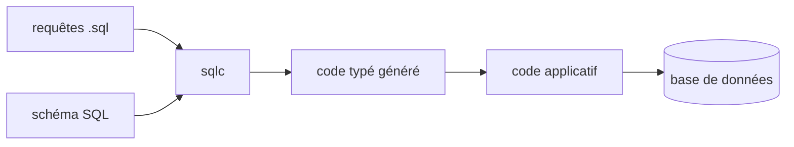

# sqlc-dev/sqlc

> Compiler that turns hand-written SQL queries into typed code.

## The problem
An ORM hides the SQL, and a hand-written query loses all compile-time type checking.
Column or type errors are then discovered at runtime.

## What it actually does
Three announced steps: you write your queries in SQL, you run sqlc, it generates typed interfaces.
Your application code then calls the generated code instead of building SQL strings.
The README does not detail dialects, target languages, or configuration.
It points to an interactive example, a playground, the documentation and the downloads page.

## How it is wired

## Trying it
No command documented in the README: it points to the Installation and Downloads pages.

## Cost and gotchas
Nothing indicated in the README: no prerequisites, dependencies or cost.

## What it is not
Not an ORM: it does not hide the SQL, it derives types from it.
Not a database client: it generates code, execution remains your responsibility.
Not documented here: this README has fewer than 800 useful characters, everything is elsewhere.

## Alternatives
None named in the README.

## For you
The principle is sound for a data API, but judge on the evidence: nothing is traceable from this README.
