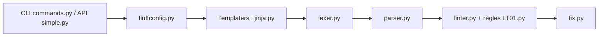

# sqlfluff/sqlfluff

> Configurable, multi-dialect SQL linter, compatible with Jinja and dbt, that fixes automatically.

## The problem
Data teams' SQL is written unevenly, and style reviews eat up time.

## What it actually does
Loads the configuration, renders templates (Jinja, dbt), splits and parses the SQL with the chosen dialect's grammar, applies lint rules and reports violations. `sqlfluff fix` corrects most of them. An optional Rust parser is installed via the `rs` extra.

## How it is wired


## Trying it
```bash
pip install sqlfluff
echo "  SELECT a  +  b FROM tbl;  " > test.sql
sqlfluff lint test.sql --dialect ansi
sqlfluff fix test.sql --dialect ansi
```

## Cost and gotchas
Free. The `rs` extra may require a Rust toolchain if no wheel exists for your platform. You must specify the dialect.

## What it is not
Not a universal formatter that works without tuning: the rules are configurable. It does not validate a query's logic.

## Alternatives
- No alternative named in the README.

## For you
Adopt: frames your SQL and dbt models in CI, installs via pip and fits effortlessly into an ELT flow.
