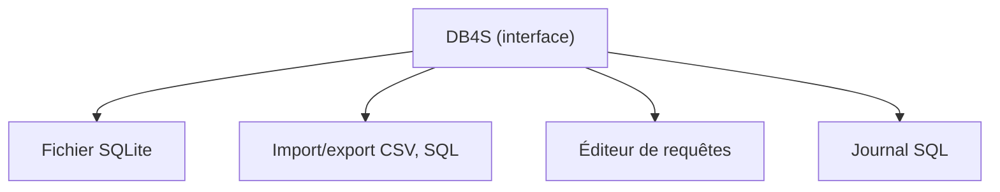

# sqlitebrowser/sqlitebrowser

> Open source graphical interface to create, browse and edit SQLite databases, without writing SQL.

## The problem
Inspecting or fixing a SQLite file from the command line is tedious.

## What it actually does
Spreadsheet-style interface: create and modify tables and indexes, browse and edit rows, import/export CSV and SQL dumps, run queries with a command log, draw simple charts. Stable version 3.13.1 (2024-10-16), continuous and nightly builds available.

## How it is wired


## Trying it
```bash
sudo apt-get install sqlitebrowser
brew install --cask db-browser-for-sqlite
winget install -e --id DBBrowserForSQLite.DBBrowserForSQLite
```

## Cost and gotchas
Free, nothing to sign up for. Debian packages are old; use the PPA or Snap for a recent version. A license is present but not identified by GitHub: to be checked.

## What it is not
Not a spreadsheet replacement, the team says so. Only concerns SQLite, not other database systems.

## Alternatives
No alternative named in the README.

## For you
Adopt: standard tool for looking at the SQLite databases of pipelines and tests, trivial to install; check the license if you redistribute.
