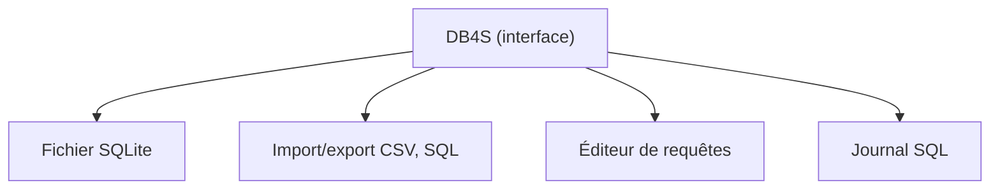

# sqlitebrowser/sqlitebrowser

> Interface graphique open source pour créer, parcourir et modifier des bases SQLite, sans écrire de SQL.

## Le problème
Inspecter ou corriger un fichier SQLite en ligne de commande est fastidieux.

## Ce que ça fait vraiment
Interface type tableur : créer et modifier tables et index, parcourir et éditer les lignes, importer/exporter CSV et dumps SQL, exécuter des requêtes avec journal des commandes, tracer des graphes simples. Version stable 3.13.1 (2024-10-16), builds continus et nightly disponibles.

## Comment c'est branché


## Essayer
```bash
sudo apt-get install sqlitebrowser
brew install --cask db-browser-for-sqlite
winget install -e --id DBBrowserForSQLite.DBBrowserForSQLite
```

## Coût et pièges
Gratuit, rien à créer. Les paquets Debian sont anciens ; PPA ou Snap pour une version récente. Licence présente mais non identifiée par GitHub : à vérifier.

## Ce que ce n'est pas
Pas un remplaçant de tableur, l'équipe le dit. Ne concerne que SQLite, pas les autres SGBD.

## Alternatives
Aucune alternative nommée dans le README.

## Pour toi
À adopter : outil standard pour regarder les bases SQLite de pipelines et de tests, installation triviale ; vérifier la licence si redistribution.

