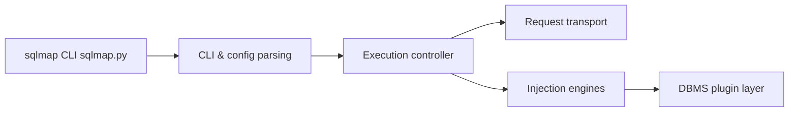

# sqlmapproject/sqlmap

> Penetration-testing tool that detects SQL injection flaws, for authorized auditors and security teams.

## The problem
Checking by hand whether a web application is vulnerable to SQL injection is slow and error-prone.

## What it actually does
A command-line Python program that probes web targets, identifies the database type and checks for injection flaws. It relies on per-technique detection engines and on plugins for each database system. An API service (`sqlmapapi.py`) lets you drive it remotely.

## How it is wired


## Trying it
```bash
git clone --depth 1 https://github.com/sqlmapproject/sqlmap.git sqlmap-dev
python sqlmap.py -h
python sqlmap.py -hh
```

## Cost and gotchas
Free, Python 2.7 or 3.x. The real cost is legal: using it on a system without written authorization is illegal in most countries.

## What it is not
It is not a scanner to run against targets you do not own. The README does not detail the legal frameworks; the license is present but not identified by GitHub.

## Alternatives
The README names no alternative.

## For you
Worth watching: relevant for testing your own data applications or APIs, within an authorized scope; check the license text before any integration.
