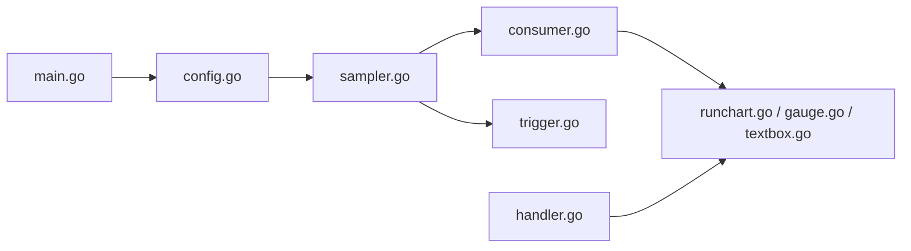

# sqshq/sampler

> Terminal tool that runs shell commands at intervals and displays them as charts, via a YAML file.

## The problem
Monitoring a metric obtained by a shell command without setting up Prometheus and Grafana.

## What it actually does
Reads a YAML, runs the commands (`sample`) at the desired rate and displays run charts, sparklines, bars, gauges, text boxes, ASCII art. Triggers launch a visual alert, a sound or a script. An interactive shell (`init`) keeps a session open to a database, SSH, JMX.

## How it is wired


## Trying it
```bash
brew install sampler
sampler -c config.yml
docker build --tag sampler .
docker run --interactive --tty --volume $(pwd)/config.yml:/root/config.yml sampler --config /root/config.yml
```

## Cost and gotchas
Free. On Linux, `libasound2-dev` for sound. Windows is "experimental". Last push February 2024.

## What it is not
Not a full monitoring system (the README says so): no storage or server. GPL-3.0.

## Alternatives
- Prometheus with Grafana: cited by the README for large-scale monitoring.

## For you
Worth watching: handy for a throwaway terminal dashboard, but no commit since February 2024; for production, prefer Prometheus and Grafana.
