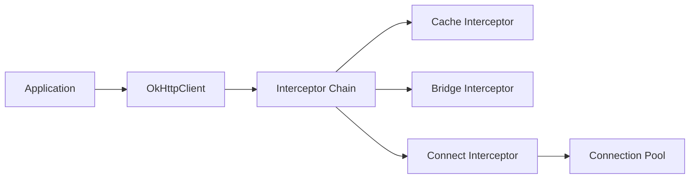

# square/okhttp

> HTTP client for Java, Kotlin and Android, with HTTP/2, connection pooling, caching and modern TLS.

## The problem
Basic HTTP clients handle unstable connections, multiplexing and recent TLS versions poorly.

## What it actually does
Sends synchronous or asynchronous requests with immutable builders, through an interceptor chain (cache, bridge, connect). HTTP/2 socket sharing, connection pool, transparent GZIP, trying alternate addresses. WebSockets, SSE, certificate pinning. Provides MockWebServer for tests.

## How it is wired


## Trying it
```kotlin
implementation("com.squareup.okhttp3:okhttp:5.5.1")
```

## Cost and gotchas
Free. Maven: choose `okhttp-jvm` or `okhttp-android` (the `okhttp` artifact is empty there). Android 5.0+ and Java 8+. Regular updates recommended for TLS fixes.

## What it is not
Not excessively configurable: no GET with a body and no replaceable cache interface. MockWebServer is no longer actively developed.

## Alternatives
No alternative named in the README (MockServer cited for testing).

## For you
Ignore unless you have a JVM/Android stack: in Python you use requests or httpx.
